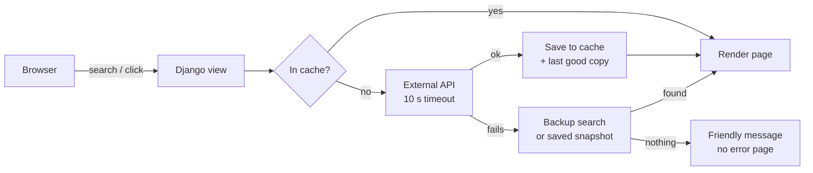

# SpoonFeed

SpoonFeed is a Django web app that helps people choose healthier and more sustainable food. It turns Open Food Facts product data and Spoonacular recipes into simple, everyday decisions, with a focus on products sold in Indonesia.

<!-- TODO: hero screenshot of the landing page (Meal of the Day carousel) -->
<!--  -->

Food production is one of the largest contributors to global environmental impact. Agriculture, packaging and transportation together make up a large share of a product's carbon footprint, yet this information is almost never visible to shoppers at the point of purchase.

Most people want to make greener choices, but nutrition labels don't show environmental data, and comparing two products' real impact (ingredients, packaging, emissions) takes research most people don't have time for. Sustainability stays an abstract goal instead of a daily habit.

SpoonFeed closes that gap. Users can:

- 🔍 Search products and see one clear grade for each
- ⚖️ Compare two or three products side by side
- 💡 Get better alternatives from the same category
- 🍽️ Plan meals around their diet, allergies and calorie goal
- ⭐ Discover a sustainable Meal of the Day and discuss it
- 📝 Read and write blog articles about sustainable food

### The SpoonFeed grade

Every product gets one overall grade from A to E, built from three public scores:

| Part | Source | Weight |
|---|---|---|
| Nutrition | Nutri-Score | 50% |
| Environment | Green-Score (Eco-Score) | 35% |
| Processing | NOVA group | 15% |

Missing parts are left out and the remaining weights are rescaled, so a product with partial data still gets a fair grade. A product with no data at all shows `?` instead of a made-up grade.

| Theme | Topic | Course | Group |
|---|---|---|---|
| Sustainable Living | Eco Mindful Living and Food Consumption | Platform-Based Programming (PBP) 2026, Midterm Project | KKI3 |

---

## Contents

1. [Links](#links)
2. [Team](#team)
3. [External APIs](#external-apis)
4. [User Roles](#user-roles)
5. [Modules](#modules)
6. [Running Locally](#running-locally)
7. [Team Workflow](#team-workflow)
8. [Contributors](#contributors)
9. [Team AI Disclosure](#team-ai-disclosure)
10. [Credits](#credits)

---

<a id="links"></a>
## 🔗 Links

| Resource | Link |
|---|---|
| Deployment (PWS) | [rebecca-love-spoonfed.pws.cs.ui.ac.id](https://rebecca-love-spoonfed.pws.cs.ui.ac.id/) |
| Figma (design system and wireframes) | [PBP Midterm Project - KKI Kelompok 3](https://www.figma.com/design/CPywGGQPpltri1IsAXi0hK/PBP-MIDTERM-PROJECT---KKI-KELOMPOK-3?node-id=0-1) |
| Repository | [pbp-group-kki3/midterm-project](https://github.com/pbp-group-kki3/midterm-project) |
| Design system page (local) | `http://127.0.0.1:8000/styleguide/` |

---

<a id="team"></a>
## 👥 Team

Click a name or NPM to go to that member's section.

| Name | NPM | Module |
|---|---|---|
| [Serafin Reysetyo Amantresno Grajo Pingol](#serafin) | [2506637136](#serafin) | Profile |
| [Rebecca Love Lianov Simanjuntak](#rebecca) | [2506637110](#rebecca) | Product Discovery |
| [Muhammad Reyhan Attarizky](#reyhan) | [2506637086](#reyhan) | Meal Plan |
| [Alyssa Rahma Adjani](#alyssa) | [2506558466](#alyssa) | Product Comparison |
| [Aryan Alexander Rinaldi](#aryan) | [2506636985](#aryan) | Meal of the Day |
| [Qeela Mufazzal Rafif Putra E](#qeela) | [2506637104](#qeela) | Blog |

---

<a id="external-apis"></a>
## 🔌 External APIs

| API | Used by | Docs |
|---|---|---|
| Open Food Facts (Indonesia, `id.openfoodfacts.org`) | Product Discovery, Product Comparison | [openfoodfacts.github.io](https://openfoodfacts.github.io/openfoodfacts-server/api/) |
| Spoonacular | Meal Plan, Meal of the Day | [spoonacular.com/food-api](https://spoonacular.com/food-api) |

### How a request flows



### Rules every module follows

- All API calls happen on the server. API keys live in `.env` and never reach the browser.
- Every call gives up after 10 seconds, so a slow API never freezes a page.
- Answers are cached in Django's cache, so repeated requests don't call the API again.
- If an API is down or out of quota, users see saved results or a short message instead of an error page.
- Automated tests mock both APIs, so they never depend on the internet or use Spoonacular points.

### Open Food Facts

Used for product search, product details, category alternatives and comparisons. Searches are cached for 1 hour and products for 6 hours. If the main search fails, the app falls back to the search-a-licious backup service, and if that also fails it shows the last good copy. The full caching design is in the [Product Discovery](#rebecca) section.

### Spoonacular

Used for recipe search, the meal planner and the Meal of the Day. Following Spoonacular's terms, results are cached for at most 1 hour and plans store only recipe IDs. Meal of the Day also stores a snapshot of each featured recipe, so it still renders when the daily points run out. See [Meal Plan](#reyhan) and [Meal of the Day](#aryan).

---

<a id="user-roles"></a>
## 🔐 User Roles

| Role | What they can do |
|---|---|
| Guest | Browse and search products, view product details and grades, read the Meal of the Day preview and blog articles, browse recipes |
| Member | Everything a guest can, plus save favorite products, compare and save comparisons, create meal plans, save meals and comment, write blog posts, set dietary preferences and see their view history |
| Admin | Everything a member can, plus manage all data through Django admin, schedule Meal of the Day entries and moderate content |

---

<a id="modules"></a>
## 🧩 Modules

Each module has its own models, views, templates and forms, server-side permission checks, and at least one interaction that updates the page without a reload.

## 👤 Profile
By [Serafin Reysetyo Amantresno Grajo Pingol](#serafin) ([2506637136](#serafin))

Manages user accounts and personal preferences. Users register, log in, edit their profile and access their saved items. They can set dietary preferences, allergies and nutritional goals, which other modules use to personalise meal plans and product results.

| Operation | What users can do |
|---|---|
| Create | Register a new account, which also creates their profile. |
| Read | View their profile, their saved products, comparisons, meals and plans, and their view history. |
| Update | Edit their profile and preferences, change their password and replace their profile picture. |
| Delete | Delete their account or profile picture, remove saved items, and delete single history entries or clear the whole history. |

## 🔍 Product Discovery
By [Rebecca Love Lianov Simanjuntak](#rebecca) ([2506637110](#rebecca))

The main page of SpoonFeed. Users search Indonesian food products, filter them, and see a short card with each product's SpoonFeed grade. The detail page explains the grade, shows nutrition, ingredients, packaging and environmental data, and recommends up to three better alternatives from the same category. Products can be saved as favorites or added to the compare tray.

| Operation | What users can do |
|---|---|
| Create | Save a product to their favorites with the heart button, or add it to the compare tray with "+ Compare". Opening a product page also adds it to their view history. |
| Read | Search, filter and sort products on the Discover page, open a product's detail page, and see better alternatives. |
| Update | Click the heart again to switch a product between saved and unsaved. Revisiting a product updates its time in the history instead of adding a duplicate. |
| Delete | Unsave a favorite or remove a product from the compare tray. History entries are deleted from the Profile page. |

## ⚖️ Product Comparison
By [Alyssa Rahma Adjani](#alyssa) ([2506558466](#alyssa))

Lets users evaluate two or three products side by side using nutrition, environmental indicators, processing scores, labels and allergens. Better values are highlighted per row. Logged-in users can save comparison lineups and manage them from their profile.

| Operation | What users can do |
|---|---|
| Create | Save the current comparison with a name and notes. |
| Read | View the comparison page, open a product's details in an overlay, and reopen saved comparisons from Profile → Saved. |
| Update | Edit a saved comparison's name and notes. |
| Delete | Remove a saved comparison, or remove a product from the active comparison. |

## 🍽️ Meal Plan
By [Muhammad Reyhan Attarizky](#reyhan) ([2506637086](#reyhan))

Generates meal plans based on the user's diet, allergies, calorie goal and planning period. It opens on a filterable recipe browser and lets users replace any meal they don't like.

| Operation | What users can do |
|---|---|
| Create | Create a meal plan for 1 to 14 days. |
| Read | Browse recipes, see the list of their plans, and open a plan day by day. |
| Update | Edit a plan's settings, or replace a single meal with another suggestion. |
| Delete | Delete a plan after confirming. |

## ⭐ Meal of the Day
By [Aryan Alexander Rinaldi](#aryan) ([2506636985](#aryan))

Features one sustainable recipe every day, shown as a slide in the landing page carousel and on its own page. Members can save the meal and join the discussion in the comments.

| Operation | What users can do |
|---|---|
| Create | Comment on the meal and save it to their profile. Admins schedule which meal appears on which day. |
| Read | See the meal in the landing carousel, open its full recipe page and read the comments. |
| Update | Switch a meal between saved and unsaved. Admins can edit scheduled meals. |
| Delete | Unsave a meal. Admins can remove scheduled meals and comments. |

## 📝 Blog
By [Qeela Mufazzal Rafif Putra E](#qeela) ([2506637104](#qeela))

Educational articles about sustainable food and responsible living: food waste, packaging, recycling, carbon footprints, sustainable shopping, nutrition labels and seasonal food. Any logged-in user can write a post.

| Operation | What users can do |
|---|---|
| Create | Write an article, or comment on one. |
| Read | Browse the blog and read articles. |
| Update | Edit their own articles. |
| Delete | Delete their own articles. |

---

<a id="running-locally"></a>
## 💻 Running Locally

### Requirements

- Python 3.11+
- Git
- A free [Spoonacular API key](https://spoonacular.com/food-api/console#Dashboard), needed only for Meal Plan and Meal of the Day
- No key is needed for Open Food Facts. It only asks for a `User-Agent` that names the app (`OFF_USER_AGENT` in `.env`)

### Setup

```bash
# 1. Clone the repository
git clone https://github.com/pbp-group-kki3/midterm-project.git
cd midterm-project

# 2. Create and activate a virtual environment
python -m venv env
# Windows (PowerShell)
env\Scripts\Activate.ps1
# Windows (Git Bash)
source env/Scripts/activate
# macOS / Linux
source env/bin/activate

# 3. Install dependencies
pip install -r requirements.txt
```

### Environment variables

Create a `.env` file in the project root:

```env
SECRET_KEY=any-long-random-string
DEBUG=True
SPOONACULAR_API_KEY=your-spoonacular-key
OFF_USER_AGENT=SpoonFeed/1.0 (your-email@example.com)
```

Without `PRODUCTION=True` the app uses SQLite, so no database setup is needed. On PWS, `PRODUCTION=True` is set together with `DB_NAME`, `DB_USER`, `DB_PASSWORD`, `DB_HOST`, `DB_PORT` and `SCHEMA` to use PostgreSQL.

### Database and data

```bash
# 4. Create the tables
python manage.py migrate

# 5. (Optional) Fill the Meal of the Day calendar from the curated recipe pool
python manage.py seed_meals

# 6. (Optional) Create an admin account
python manage.py createsuperuser

# 7. Start the server
python manage.py runserver
```

Then open http://127.0.0.1:8000/.

### Running the tests

```bash
# Unit and integration tests (APIs are mocked, no internet needed)
python manage.py test

# With coverage
coverage run manage.py test
coverage report

# Selenium functional tests for Discover (needs Chrome)
pip install -r requirements-for-selenium-test.txt
python manage.py test main.tests_functional
```

---

<a id="team-workflow"></a>
## 🔀 Team Workflow

- One branch per feature (`feat/main`, `feat/comparison`, `feat/meal-plan`, and so on), merged into `main` only through a pull request reviewed by a teammate.
- Commits follow Conventional Commits (`feat(main): ...`, `fix(comparison): ...`, `test(meal_plan): ...`, `docs: ...`).
- Shared files (`templates/base.html`, `static/css/`, `requirements.txt`, `midterm_project/urls.py`) are only changed after checking with the team, so nobody's work gets overwritten.
- All pages use the global tokens and components in `static/css/` (`tokens.css`, `base.css`, `components.css`, `pages.css`), documented on the `/styleguide/` page.
- AI tools never commit, push or merge. All git work is done by the team members themselves.

---

<a id="contributors"></a>
## 🙌 Contributors

<a id="serafin"></a>
### 👤 Serafin Reysetyo Amantresno Grajo Pingol

**Module:** Profile &nbsp;|&nbsp; **NPM:** 2506637136

The Profile module handles everything about a user's account: signing up, logging in, their details and preferences, and what they've saved or viewed.

### ✨ Highlights

The module is made up of six parts:

- Registration
- Login
- Account
- Preferences
- Saved/Favourites
- History

<!-- TODO (Serafin): a short description of each part and its key technical details -->

### 🤖 AI Disclosure

**Models used**

| Model | Used for |
|---|---|
| Google Gemini 3.1 and 3.6 | Bug fixing, understanding how to implement certain features, and translating the Figma designs into code |

**How prompts were written**

- Prompts gave as much context and detail as possible, so little was left to interpretation.
- Every result was checked for possible issues or regressions before it was implemented.
- AI stayed in a limited, supporting role. It was never used for git commands and was never left to build things on its own.

**Limitations and manual fixes**

| Problem | What went wrong | How it was fixed |
|---|---|---|
| HTML visuals | The AI struggled to produce a good-looking result and needed many iterations | Manual changes to the templates and styling |
| Regressions | Random hallucinations and regressions, especially when context or specifications were missing | Most manual fixes reversed regressions and syntax conflicts, especially around file names, conventions and directories |

### 📌 Dev Note

<details>
<summary>Commit convention</summary>

The commit convention is followed from 28 October 2026 onwards, after an earlier misunderstanding. Older commits are left unchanged for stability and safety. Their conventional counterparts are listed below.

| Original commit hash and message | Conventional commit counterpart |
| :--- | :--- |
| `298c3b0c9ab55f6b381823fff073836237c4f15d`<br>testing git quickly | `test(main): testing git` |
| `b9b63eddb77b19937476a0d8288736e6bbadb1dd`<br>Initial Profile Setup | `chore/feat(profiles): initial setup and framework` |
| `0b95267dc14d4d1a21b9db8b0ffb007f2663f486`<br>Append to prior commit | `chore(profiles): committing files that were left out` |
| `f0cab38a052ab1d410f109ad6f4b6d3835e2c4d1`<br>Initial Profile Model | `feat(profiles): added profiles model` |
| `29c2a3fca3fb1a272f88714691705335ae119c7d`<br>Profiles view | `feat(profiles): added profiles view` |
| `328e28a861aced4254a043e709d68ae1c8f5b73a`<br>Forgot to stage again this is for prior commit | `chore(profiles): committing files that were left out` |
| `ab956a8c1d62dd8542816bb87d6f818c83c08335`<br>Register view and HTMLs set up and created | `feat(profiles): added register html and view` |
| `9fe9843e696dce7b9715dd614c006fe0c6f7b09e`<br>PROFILE SPEEDRUN | `feat/refactor(profiles): added login system and profile html, refactored the code to be cleaner and better fit the requirements` |
| `690e61eb30ac58af9ee072c414cf5f12933edbf5`<br>APPEND | `chore(profiles): committing files that were left out` |

</details>

[Back to team](#team)

---

<a id="rebecca"></a>
### 🔍 Rebecca Love Lianov Simanjuntak

**Module:** Product Discovery &nbsp;|&nbsp; **NPM:** 2506637110

Product Discovery is the main page of SpoonFeed (the `main` app): live product search with filters, the SpoonFeed grade, product detail pages with better alternatives, favorites, view history, and the compare tray that leads into the Comparison module.

<!-- TODO: GIFs, e.g. docs/readme/discover-search.gif, docs/readme/favorite-toast.gif, docs/readme/compare-tray.gif -->
<!--  -->

### ✨ Highlights

**API caching and resilience**

Open Food Facts is a free, community-run API that is sometimes slow or answers `503 Too busy`. `main/services/openfoodfacts.py` uses several cache layers so the page keeps working when the API doesn't:

| Layer | What it does | Duration |
|---|---|---|
| Normal cache | Search results, the popular products list and category alternatives, so repeated searches never call the API again | 1 hour |
| Product cache | A product's full detail (nutrition, ingredients, packaging, eco data) | 6 hours |
| Last good copy | Every successful answer is saved a second time as a long-term backup | 7 days |
| "API is down" flag | When the API and the backup both fail, the app stops calling them for a while instead of making every user wait 10 seconds, which also avoids hammering the API | 90 seconds |
| Backup search | If the normal search fails, the app asks Open Food Facts' search-a-licious service instead | per request |

- When the last good copy is served, the list is marked as saved earlier (`StaleList`) and a toast tells the user these are saved results.
- Every failure type is caught in one place (`call_api`): no network, timeouts, HTTP errors, non-JSON answers and JSON in the wrong shape.
- Search text is turned into a fixed-length MD5 key (`off:search:3f2a...`), because raw text with spaces triggered Django cache-key warnings.
- A product that doesn't exist, a search with no results and an API failure each show their own message.
- The Comparison module reuses `get_product`, so a product loaded on Discover opens instantly on Comparison.

**Security**

- Custom decorators in `main/decorators.py`:
  - `@rate_limit` allows at most 60 searches, 30 heart clicks and 40 compare clicks per minute per user or IP, counted in the cache. Going over returns `429` and a "Slow down" toast.
  - `@login_required_json` keeps the normal login redirect for forms, but answers JavaScript and HTMX clicks with `401` JSON, so the page can send the user to login and bring them back afterwards.
- Barcodes must be digits only (max 32) before they go into an API URL, which blocks path tricks like `../`. Search text has HTML stripped, extra spaces removed and is cut to 100 characters. All filters go through a Django form (`DiscoverFilterForm`) that drops unknown values instead of crashing.
- Views that change data are POST-only (`@require_POST`) with CSRF tokens. JavaScript clicks send the form's token in the `X-CSRFToken` header.
- Every `next` URL is checked with `url_has_allowed_host_and_scheme`, so there are no open redirects.
- The product detail page uses `@never_cache`, because it shows personal data such as the saved state.
- A `UniqueConstraint` allows one favorite per user per product, and history uses `update_or_create`, so there are no duplicate rows.

**Interactivity**

- HTMX live search and filters update the results as the user types and clicks, without a page reload. `hx-push-url` keeps the URL shareable and the Back button working.
- The favorite heart turns red instantly and rolls back if the server refuses, with a shared toast either way.
- "Load more" adds the next products without reloading.
- The compare tray updates live from the `+ Compare` buttons.
- If the internet drops or the server crashes, the page stays where it is and a toast explains what happened, instead of the browser's error page.
- The hero carousel respects `prefers-reduced-motion`.
- Logged-in users see a "Fits your preferences" chip on products that match the diet and allergies saved in their Profile.

**Testing**

- 151 unit and integration tests in 27 test classes, covering grading, caching, API failures, backup search, input safety, rate limits, JSON login, favorites, history, filters and the compare tray.
- 5 Selenium functional tests for the Discover page in a real browser.
- Open Food Facts is mocked everywhere, so the tests never need the internet.

**Design system**

The global CSS (`static/css/tokens.css`, `base.css`, `components.css`, `pages.css`) was built from the team's Figma design system, together with the local `/styleguide/` page that shows every token and component. This way all six members build pages with the same buttons, cards, chips, dialogs and toasts.

### 🤖 AI Disclosure

**Models used**

| Model | Used for |
|---|---|
| Claude Opus 5.5 | The harder parts: architecture planning, debugging, and consulting on design decisions (for example, how the cache should behave when the API is down). Also helped turn the Figma design system into the global CSS and build the `/styleguide/` page. |
| Claude Sonnet 5.5 | Easier, repetitive work, such as test boilerplate and similar template changes across files |

**How prompts were written**

- Work was split into small steps, each with a test scenario that was run by hand before moving on.
- Layouts were checked against the exact Figma frame, not the AI's own idea of the page.
- Every step was checked against the midterm grading rubric.
- Every edit was marked with a `# change:` comment explaining what changed and why, so all of the code could be understood and explained.
- Before any shared file was touched, the change was checked against teammates' branches for conflicts.

**Limitations and manual fixes**

| Problem | What went wrong | How it was fixed |
|---|---|---|
| Saved hearts showed as empty on search cards | The cards always drew an empty heart, even for saved products, because the search page didn't know which products the user had saved | `saved_barcodes()` loads the user's saved barcodes once per page as a set, so each card checks it without extra database queries |
| Clicking the heart reloaded the page | The heart was a plain form, so every click reloaded the page and jumped back to the top | `toggle_favorite` answers JavaScript clicks with JSON, and `main.js` updates the heart optimistically with rollback |
| Cache keys broke on normal searches | Raw search text was used as the cache key, so a search like "susu uht" triggered a Django cache-key warning | The cleaned search text is hashed into a fixed-length key (`cache_key`) |
| HTMX check was too broad | Partial responses were decided by the `HX-Request` header, but HTMX also sends it when restoring a page for the Back button, so going back showed half a page | History-restore requests get the full page, and only the "Load more" fetch gets a partial response |
| Rate-limit counters added up across the team's tests | In tests every client looks like the same visitor, so the rate limit started blocking other modules' tests during a full run | The test client is skipped by the counter, and the rate-limit tests use a real host name so the limit itself is still tested |
| HTML started before the shared CSS existed | The AI was ready to style pages before the team's global CSS was merged, which would have meant redoing them later | HTML work was paused until the shared design system landed, and every page was then built from the shared components |

[Back to team](#team)

---

<a id="reyhan"></a>
### 🍽️ Muhammad Reyhan Attarizky

**Module:** Meal Plan &nbsp;|&nbsp; **NPM:** 2506637086

Meal Plan creates personalised meal plans from Spoonacular recipes and lets users browse recipes, edit plans and replace single meals.

<!-- TODO: GIF, e.g. docs/readme/meal-plan-create.gif -->

### ✨ Highlights

- The Recipes page is Meal Plan's landing page. It searches Spoonacular recipes with filters for meal, diet (several at once: vegetarian, vegan, pescatarian, ketogenic and halal), max kcal, max minutes, gluten free, dairy free and sustainable. "Load more recipes" adds the next page with AJAX, without reloading.
- Creating a plan takes a name, start date, 1 to 14 days, diets, allergies, an optional daily snack and a calorie goal. The form is filled in from the user's Profile preferences, and the plan summary updates live. Spoonacular's meal planner picks breakfast, lunch and dinner for each day. Allergies are excluded, and halal skips pork and alcohol (labelled "Halal not verified", since Spoonacular can't confirm halal).
- The plan page shows each day with its meals, photos, cooking time, calories, macros and a daily calorie total. "Jump to" day chips follow the user while scrolling. All recipes in a plan load in one bulk API call.
- Replacing a meal opens a dialog that loads three recipes fitting the plan's diet, allergies and calories with AJAX, and "Show other options" loads more without leaving the page.
- Editing a plan keeps the meals if only the name or start date changes. Changing the days, diet, allergies, snack or calorie goal picks new meals.
- Plans can be deleted with a confirmation dialog, and My plans lists all of them.
- If Spoonacular is down or out of points, pages show a short message instead of an error, and saved plans stay viewable.
- Every page needs a login, and every plan and meal is checked against its owner. All forms use CSRF tokens and are validated on the server (for example, days 1 to 14, calories 1,000 to 5,000, and ketogenic can't be combined with plant-based diets). A replacement meal must be one the server actually offered. Everything shown on the page is escaped, outside links are checked before they're shown, and the Spoonacular key stays in `.env` and is only sent in a request header.
- The module follows Spoonacular's terms: plans store only recipe IDs, and API results are cached for 1 hour, the maximum the terms allow.
- Layouts are responsive for desktop, tablet and phone, following the Figma (the replace dialog becomes a bottom sheet on phones), and the dropdowns work with the keyboard.
- 102 automated tests, including security tests. They mock Spoonacular, so they never use API points.

### 🤖 AI Disclosure

**Models used**

| Model | Used for |
|---|---|
| Claude Opus | Most of the `meal_plan` code and its tests, running tests on teammates' PRs, and checking pages in a browser against the Figma |

**How prompts were written**

- Claude was given what to build, as agreed with the group, plus the team's Figma design through the read-only Figma connector and read-only access to the code.
- It worked in a separate copy, ran the tests, and checked the pages in a browser against the Figma.
- For teammates' PRs it ran the tests and flagged issues, but the review decisions stayed with Reyhan.
- It never committed, pushed or merged anything. All git work and every PR was done by Reyhan, after reviewing the change and running the tests locally.
- Outside `meal_plan`, it only touched the Saved page in `profiles` when the team asked for it.

**Limitations and manual fixes**

| Problem | What went wrong | How it was fixed |
|---|---|---|
| No real API calls | It couldn't call Spoonacular for real without using the team's daily points | Pages were previewed with a fake Spoonacular, and the tests mock the API |
| No GitHub access | It couldn't see GitHub review status | Review status was passed along manually |
| Stale changes | Some changes went out of date when teammates' PRs changed the same files first | Those changes were rebuilt on top of the latest `main` |
| Wrong claims | A few of its claims turned out to be wrong | They were corrected after testing in a real browser |

[Back to team](#team)

---

<a id="alyssa"></a>
### ⚖️ Alyssa Rahma Adjani

**Module:** Product Comparison &nbsp;|&nbsp; **NPM:** 2506558466

The Product Comparison module lets users evaluate two or three food products side by side using nutritional information, environmental indicators, processing scores, labels and allergens. Logged-in users can also save and manage comparison lineups through their profiles.

<!-- TODO: GIF, e.g. docs/readme/comparison.gif -->

### ✨ Highlights

**Field-level comparison and highlighting**
- Comparison logic lives in reusable service functions rather than in the templates.
- Scores and nutritional fields follow their own comparison direction to find the better available value.
- Missing data is evaluated separately for each row, so two valid values can still be compared when a third product has no information.
- Rows with fewer than two comparable values, or entirely equal values, get no "Better" highlight.
- Missing values stay visibly unavailable instead of being treated as zero.

**Saved comparison management**
- Saved comparisons store the owner, name, optional notes, product barcodes and creation time.
- Saved comparisons are reopened through Profile → Saved → Comparisons.
- Editing changes only the name and notes. It doesn't replace the saved lineup or transfer ownership.
- Removing a saved comparison deletes the saved record without deleting products or changing the active comparison.
- Saved comparisons keep the selected barcodes. They are not frozen snapshots of old product information.

**Product detail overlay**
- Each Details button loads the product inside a native `<dialog>` without leaving the Comparison page.
- The overlay reuses the existing product detail content and preparation logic.
- Recommendations and global page elements are left out of the popup.
- Controls that would change the comparison are locked inside the overlay, to keep the lineup being reviewed.
- Loading, failure and retry states show the progress of the request.
- Request cancellation and stale-response checks stop an earlier request from replacing a more recently selected product.

**Accessible and responsive interactions**
- The overlay has an accessible close button, closes with Escape, manages focus, and returns focus to the Details button that opened it.
- Background scrolling is locked while the overlay is open and restored when it closes.
- A bounded dialog height with internal scrolling keeps long product details usable on any screen.
- Save, Edit and Remove reuse SpoonFeed's shared buttons, icons, dialogs and notifications.
- Asynchronous actions show loading states and disable controls while submitting.

**Authorization and session protection**
- Viewing, editing and deleting saved comparisons is restricted by server-side ownership filters using both the record ID and `request.user`.
- New saved comparisons take their owner from the logged-in user, never from submitted data.
- Editing ignores submitted attempts to change ownership or product barcodes.
- Endpoints that change data require POST and keep Django's CSRF protection.
- Session validation handles malformed selections and stops invalid or oversized lineups from enabling Save.
- Opening a saved comparison doesn't overwrite the active comparison tray.
- Personalised comparison responses use `@never_cache` so private content isn't cached.

**Failure feedback**
- Missing, inaccessible or invalid saved records show a dedicated "Saved comparison unavailable" page with a link back to Saved.
- Another user's record IDs and nonexistent IDs get the same failure response, so other users' saved records are never revealed.
- Asynchronous actions give validation, authentication and security-error feedback.
- Security failures are handled before assuming the server response is JSON.

**Automated testing**
- Tests cover saved comparison CRUD, valid and invalid forms, highlighting rules, missing product information and active tray behaviour.
- Authorization tests check foreign record IDs, alternative removal routes, forged identifiers and ownership preservation.
- Request protection tests cover missing or incorrect CSRF tokens and untrusted request origins.
- Session tests cover isolation between users, malformed data, cleared login sessions and cache-control headers.
- External product lookups are mocked, so tests don't depend on the live API.

**Shared design system contribution**
- Reuses SpoonFeed's global button, icon, dialog and typography components.
- Added the SpoonFeed SVG favicon through the shared base template, so every page shows the same browser tab icon.

### 🤖 AI Disclosure

**Models used**

| Model | Used for |
|---|---|
| ChatGPT-6.1 Sol Medium and Codex | Agentic pair programming in Visual Studio Code: comparison rules, design system integration, the detail overlay, saved comparisons, authorization and tests |

**How prompts were written**

- The work was divided into focused tasks (comparison rules, shared design system integration, product detail overlays, saved comparison management, authorization and testing). Each request included the relevant files and the expected behaviour.
- The AI was asked to inspect the current implementation before proposing changes, reuse existing Django preparation logic and shared components, and leave unrelated work untouched.
- For many changes, complete code and placement instructions were requested through chat, so the implementation could be understood and applied by hand.
- Screenshots, tracebacks and test failures were shared to refine the implementation. Tests were used to check behaviour and prevent regressions; this was not a strictly test-driven process.

**Limitations and manual fixes**

| Problem | What went wrong | How it was fixed |
|---|---|---|
| Incomplete comparison when one product had missing data | Highlighting stopped for a whole row when one selected product lacked information, even when the other two had valid values | Available values are now compared independently for each row. Highlighting needs at least two comparable values, missing values are excluded, and fully equal rows stay unhighlighted |
| Overlay didn't match the existing interface | Earlier suggestions added an extra "Product details" heading and content that wasn't needed inside the popup | The overlay reuses the existing product detail interface, without recommendations, global navigation, footer, comparison tray or page-level back links, and keeps an accessible close control |
| Missing cache decorator found by security testing | The manually integrated implementation left out `@never_cache` on the Comparison page, so the cache-protection test failed | The decorator was added and its placement on the Save endpoint made consistent, so personalised responses get the intended cache-control headers |
| Outdated test assertions | A test still expected the old comparison help text after the visible wording changed | The assertion was updated to match the intended interface, keeping the checks for equal-value behaviour |
| Cross-module assumptions | Reviewing only the Comparison module didn't reveal that Main's product selection controls still required login, although Comparison supports guest access | The full Discover-to-Comparison flow was inspected, the conflicting decorators and template conditions were found, and the fix was coordinated with the Main module owner |

[Back to team](#team)

---

<a id="aryan"></a>
### ⭐ Aryan Alexander Rinaldi

**Module:** Meal of the Day &nbsp;|&nbsp; **NPM:** 2506636985

The Meal of the Day module delivers a daily recipe recommendation that works both as a feature in the homepage carousel and as a recipe page of its own, with community interactions.

<!-- TODO: GIF, e.g. docs/readme/meal-of-the-day.gif -->

### ✨ Highlights

**Immutable snapshot architecture**
- Instead of storing a foreign key or remote ID that breaks if external recipes change or Spoonacular is unavailable, saving a meal stores an immutable snapshot (`snapshot_data = models.JSONField(...)`).
- If an admin clears or re-seeds the meal calendar, users keep their saved meals in their profiles (`on_delete=models.SET_NULL`).
- If Spoonacular hits its limits or goes down, `prepare_meal_context` falls back to rendering from database snapshots instead of showing an error.

**JavaScript interactivity**
- Clicking Save sends an async `fetch()` POST with CSRF verification and updates the UI optimistically (the heart turns pink and the text changes to "Saved"), syncs every matching button on the page, and shows a toast.
- Comments are submitted through `submitComment(event, mealID)`: the comment is sent with AJAX and added to the page with a slide-in animation (`commentFadeIn`), a generated user avatar and a live comment counter, all without reloading.
- The "See recipe" toggle scrolls smoothly, flips its label and arrow, and pauses the carousel's auto-slide while the user is reading.

**Security hardening**
- Failed or invalid API requests are cached negatively for 5 minutes (`cache.set(key, False, 300)`), so spamming lookups for non-existent recipes can't exhaust Django worker threads.
- `_get_safe_redirect_url` validates `HTTP_REFERER` headers with Django's `url_has_allowed_host_and_scheme(require_https=...)`, blocking open-redirect phishing.
- External source and image URLs are validated with `is_safe_external_url`, so only `http://` and `https://` links are rendered (blocking `javascript:`, `data:` and `file:`).
- A 10-second cooldown per user and featured meal prevents duplicate comment spam.
- When saving, the backend ignores recipe titles sent by the client and takes the title only from trusted server-side snapshots.
- All external recipe links use `target="_blank"` and `rel="noopener noreferrer"`.

**Curated seeding command (`seed_meals`)**
- A custom Django management command (`python manage.py seed_meals`) backed by an internal pool of 100 verified Spoonacular recipe IDs.
- It can seed 365 days of recommendations without duplicates, respects dates an admin set by hand, and preserves the daily API quota.

**Test coverage**
- 50 unit and integration tests covering models, uniqueness constraints, sanitisation, open-redirect defences, negative caching, AJAX toggles and cross-module profile integration.

### 🤖 AI Disclosure

**Models used**

| Model | Used for |
|---|---|
| Google Gemini 3.8 Flash | Agentic pair programming in Antigravity: schema and migrations, API integration, UI, async interactivity, the snapshot architecture, and security auditing |

**How prompts were written**

- Instead of asking for a complete application in one pass, the AI was used to build in deliberate, verifiable stages: database schema and migrations, data services and API integration, design system UI/UX, async interactivity, offline snapshot architecture, and security audit and hardening.
- The focus was on the AI's strengths, such as detailed risk auditing and implementing difficult concepts, rather than leaving everything to it.
- Django's test suite was run after every iteration as a regression check, keeping a 100% pass rate throughout.

**Limitations and manual fixes**

| Problem | What went wrong | How it was fixed |
|---|---|---|
| DOM ID collision on nested templates | When `slide.html` was included on `detail.html`, the hidden preview and the main panel both rendered `#save-recipe-btn`. `document.getElementById` picked the hidden one, so the visible button didn't change back after unsaving | The slide's embedded panel is gated with ``, and `updateSaveButtons(mealId, isSaved)` updates every matching button with `querySelectorAll` |
| Figma geometry and rhythm | The first CSS layout used generic Tailwind spacing that didn't follow the design system | Padding (`48px 56px`), column gaps (`56px`), image radius (`var(--radius-xl)`) and line height (`1.22`) were refined by hand to match the Figma wireframe |
| Control characters in comments | Non-printable control characters could cause terminal injection in backend loggers, and raw null bytes triggered Django field errors before custom clean methods ran | Control characters are stripped with a regex in `MealCommentForm.clean_text`, verified with dedicated test cases |

[Back to team](#team)

---

<a id="qeela"></a>
### 📝 Qeela Mufazzal Rafif Putra E

**Module:** Blog &nbsp;|&nbsp; **NPM:** 2506637104

The Blog module provides educational content about sustainable food consumption and environmentally responsible lifestyles. It helps users understand the information shown elsewhere in the app and encourages more sustainable daily habits. Articles cover food waste, packaging, recycling, carbon footprints, sustainable shopping, nutrition labels, seasonal food and responsible consumption.

### ✨ Highlights

<!-- TODO (Qeela): what was added (security, interactivity, testing) -->
Coming soon.

### 🤖 AI Disclosure

<!-- TODO (Qeela): models, prompt strategy, limitations and manual fixes -->
Coming soon.

[Back to team](#team)

---

<a id="team-ai-disclosure"></a>
## 🤖 Team AI Disclosure

AI was used throughout the project as a design, planning and coding assistant. Every AI suggestion was reviewed by a team member, and AI tools never committed, pushed or merged code. Each member's own use of AI is described in their section above.

The design process went like this:

1. **Design system by hand.** Rebecca and Alyssa designed the initial design system (colours, typography, components) and the first frames by hand in Figma.
2. **Layout drafts with AI.** Page layouts were discussed with Claude (Rebecca) and Codex (Alyssa). Both were connected to the Figma file through connectors, so they could read the design system and create layout drafts directly in Figma.
3. **Final wireframe.** The final wireframe is a mix of manual design and AI help. Layout, spacing, hierarchy and copy were designed and refined by hand, while AI took over the repetitive work, such as repeating components across frames and building the desktop and mobile variants. Each AI draft was kept, changed or rejected.
4. **Design system in code.** The global CSS (`static/css/`) and the `/styleguide/` page were built from the Figma design system with Claude Opus 5.5, so all six modules share the same tokens and components.

<!-- TODO (team): additional details about the team's AI use -->

---

<a id="credits"></a>
## 📚 Credits

- Product data from [Open Food Facts](https://world.openfoodfacts.org/), available under the [Open Database License](https://opendatacommons.org/licenses/odbl/1-0/).
- Recipe data from the [Spoonacular API](https://spoonacular.com/food-api).
- Built for the Platform-Based Programming (PBP) course, Faculty of Computer Science, Universitas Indonesia, 2026.
